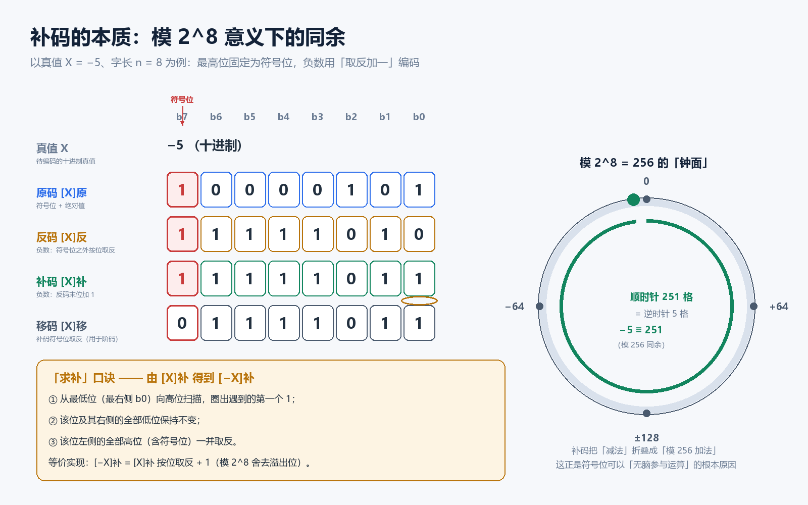
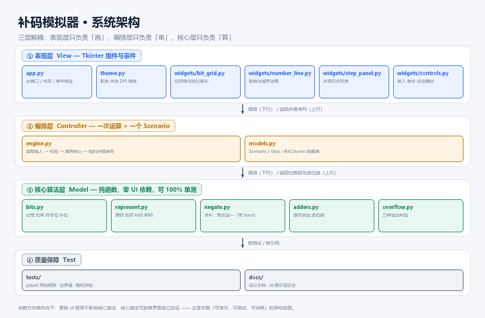
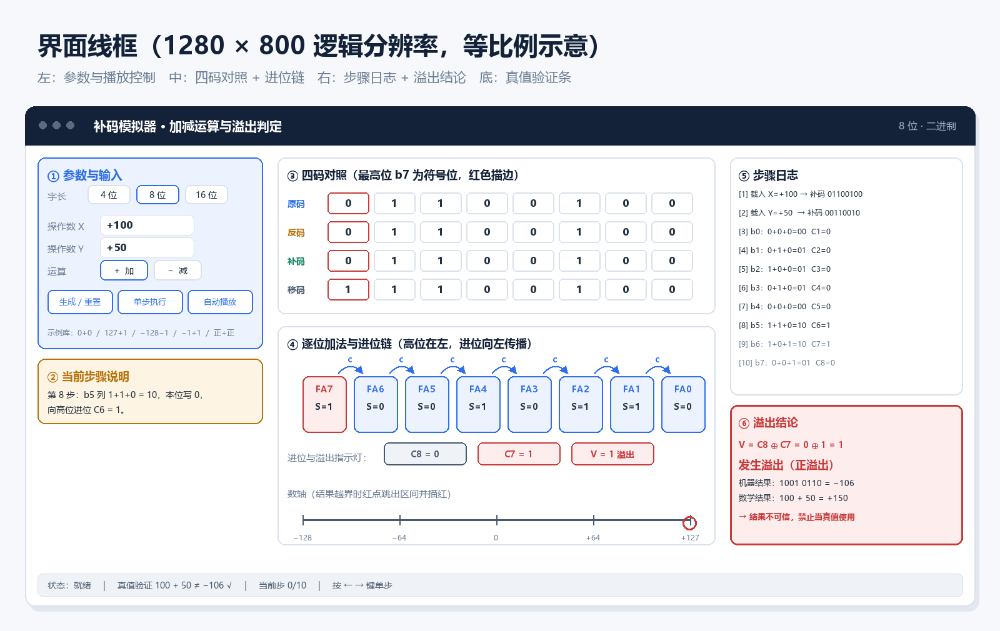

# 补码模拟器：项目需求与设计文档

> **课程**：计算机科学基础 · 综合实验（Vibe Coding 与 Git 团队协作）
> **选题**：补码加减法运算模拟器（重点展示**求补过程**与**溢出判断**）
> **项目组**：补码不补脑
> **文档版本**：v0.9（选题审核稿）
> **更新日期**：2026-11-07

---

## 目录

1. [文档信息与修订记录](#一文档信息与修订记录)
2. [项目背景与选题依据](#二项目背景与选题依据)
3. [项目目标与范围](#三项目目标与范围)
4. [术语与数学基础](#四术语与数学基础)
5. [需求分析](#五需求分析)
6. [系统设计](#六系统设计)
7. [界面设计](#七界面设计)
8. [团队分工](#八团队分工)
9. [Git 协作规范](#九git-协作规范)
10. [测试计划](#十测试计划)
11. [进度计划](#十一进度计划)
12. [风险与应对](#十二风险与应对)
13. [交付物清单](#十三交付物清单)
14. [参考资料](#十四参考资料)

---

## 一、文档信息与修订记录

| 项目 | 内容 |
| :--- | :--- |
| 文档名称 | 《补码模拟器项目需求与设计文档》 |
| 对应交付物 | `Project_Requirements_and_Design.md` |
| 维护人 | 成员E（技术文档工程师） |
| 审核人 | 马子尊（项目负责人） |
| 当前状态 | **待教师选题审核** |

| 版本 | 日期 | 修订人 | 修订说明 |
| :--- | :--- | :--- | :--- |
| v0.1 | 第 1 周 | 成员E | 初稿：选题背景、功能清单 |
| v0.5 | 第 1 周 | 成员B | 补充求补算法、进位链与溢出判定三法 |
| v0.8 | 第 2 周 | 成员C / 成员D | 补充界面线框与可视化映射表 |
| v0.9 | 第 2 周 | 马子尊 | 汇总五人分工、Git 规范与里程碑，提交审核 |

---

## 二、项目背景与选题依据

### 2.1 概念痛点

《计算机科学基础》中「数在计算机中的表示与运算」一节，是学生**第一次**接触"机器数"与"真值"分离的地方。它难，不在于规则多，而在于三条反直觉的设定同时出现：

- **符号位参与运算**。学生习惯"符号单独处理"，而补码要求把符号位当成普通二进制位一起加。
- **减法被改写成加法**。`X − Y` 实际执行 `[X]补 + [−Y]补`，中间的"求补"一步最容易算错。
- **结果可能"绕回"**。`100 + 50` 在 8 位机器上得到 `−106`，若不做溢出判断，学生会把错误答案当成真值背下来。

教材上的推导是静态的：一张表、几行竖式。学生抄得下来，却**看不见进位在列间流动**，也**看不见符号位与数值位的边界**在哪里。这正是可视化能补位的地方。

### 2.2 选题与作业要求的对应

作业在"选题建议"中明确点名了本方向：

> 补码加减法运算模拟器（**重点展示求补过程和溢出判断**）

本项目的功能设计即围绕这两个"重点"展开，其余功能（四码对照、数轴、日志）均为支撑，不喧宾夺主。

### 2.3 与示例工程《图灵机互动演示系统》的对照

| 维度 | 示例：图灵机回文判定 | 本项目：补码模拟器 | 借鉴与差异 |
| :--- | :--- | :--- | :--- |
| 抽象对象 | 状态机 + 无限纸带 | 定长位串 + 进位链 | 示例用"位置高亮"，我们用"列高亮 + 进位箭头" |
| 核心交互 | 单步 / 自动播放 / 调速 | 同左，另加"逐列推进" | **直接复用**示例的播放控制范式 |
| 规则表 | 右侧转移函数表实时高亮 | 右侧步骤日志 + 溢出结论卡 | 示例的"规则高亮"改为"步骤高亮" |
| 技术栈 | Python + Tkinter，1250×760 | Python + Tkinter，1280×800 | 与示例保持一致，降低风险 |
| 分工规模 | 6 人 | **5 人** | 合并"展示"与"QA"，PM 兼架构集成 |
| 数据驱动 | 状态表字典 | `Scenario` 对象 + 步骤序列 | 本项目把"规则表"升级为"可序列化的步骤流" |

**结论**：示例证明了"Python + Tkinter + 单步播放 + 右侧日志"这条技术路线在两三周内可交付。本项目沿用其骨架，把领域逻辑从"状态转移"换成"位运算"，风险可控。

---

## 三、项目目标与范围

### 3.1 目标

开发一个**零第三方依赖**的桌面演示程序，让使用者在 30 秒内看懂三件事：

1. 一个负数是怎么被**编码**成补码的（原码 → 反码 → 补码的逐位变化）；
2. 两个补码是怎么**相加**的（进位从低位向高位传播，符号位一起参与）；
3. 结果什么时候**不可信**（三种溢出判定方法给出同一结论）。

### 3.2 范围内（In Scope）

- 字长 **4 / 8 / 16** 位可切换，符号位固定为最高位；
- 操作数以**十进制真值**或**二进制补码串**两种方式输入；
- 原码、反码、补码、移码**四码并列对照**；
- **求补过程**（取反 + 加一）逐步演示；
- 补码**加 / 减**法逐列演示，含完整进位链；
- **三种溢出判定**并列展示并给出一致结论；
- 结果补码**反解真值**，并与数学结果对照；
- 单步、自动播放、调速、重置、示例库；
- 步骤日志可复制 / 导出为文本。

### 3.3 范围外（Out of Scope）

- 乘除法、浮点数（IEEE 754）、BCD 码；
- 任意精度大整数运算；
- 网络功能、账号系统、数据持久化到数据库；
- 自动生成教学 PPT 或视频；
- 移动端 / Web 端适配（本期只做桌面）。

> **范围控制说明**：作业要求是"轻量级可视化程序"，上述排除项均不影响对"求补"和"溢出"两个重点的展示。若后期有余力，乘法可作为 v2.0 的扩展，不列入本期验收。

---

## 四、术语与数学基础

| 术语 | 英文 | 定义 |
| :--- | :--- | :--- |
| 真值 | True Value | 带符号的十进制数值，如 `−5` |
| 机器数 | Machine Number | 真值在机器中的二进制编码，含符号位 |
| 字长 | Word Length | 机器数位数 `n`，本项目取 4 / 8 / 16 |
| 符号位 | Sign Bit | 最高位 `b(n−1)`，`0` 为正、`1` 为负 |
| 模 | Modulus | `2^n`，8 位时为 256 |
| 变形补码 | Modified Complement | 双符号位形式，用 `00/11/01/10` 表示结果状态 |
| 进位链 | Carry Chain | 各列向高位传递的进位序列 `C0…Cn` |

### 4.1 四个码制的关系（以 8 位、`X = −5` 为例）



<center><b>图 1</b>　四码逐位对照与模 256 钟面（`−5 ≡ 251`）</center>

- **原码**：符号位 + 绝对值，`−5 → 1000 0101`；
- **反码**：负数在符号位不变的前提下按位取反，`→ 1111 1010`；
- **补码**：反码末位加一，`→ 1111 1011`。它满足 `[X]补 = 2^n + X (mod 2^n)`；
- **移码**：补码符号位取反，`→ 0111 1011`，用于浮点阶码的大小比较。

> **关键理解**：补码不是"另一种约定"，而是 `mod 2^n` 同余类的一个代表元。`−5` 与 `251` 在模 256 下同余，所以"减 5"与"加 251"是同一件事。这条性质解释了为什么符号位可以不加区分地参与加法。

### 4.2 两条核心公式

```text
加法：  [X + Y]补 = [X]补 + [Y]补          （mod 2^n，丢弃符号位向外的进位）
减法：  [X − Y]补 = [X]补 + [−Y]补
求补：  [−Y]补 = ~[Y]补 + 1                （连同符号位整体取反再加一）
```

### 4.3 三种溢出判定

设 `C_n` 为符号位向外的进位，`C_(n−1)` 为最高数值位向符号位的进位。

| 方法 | 判据 | 优点 | 局限 |
| :--- | :--- | :--- | :--- |
| ① 单符号位进位异或 | `V = C_n ⊕ C_(n−1)` | 电路只需一个异或门，最省硬件 | 对初学者不直观，需要先理解进位 |
| ② 双符号位（变形补码） | `00/11` 正常，`01` 正溢，`10` 负溢 | 一眼看出溢出方向，最适合课堂讲解 | 需要额外一位，不是真实机器格式 |
| ③ 操作数符号法 | 同号相加得异号 → 溢出 | 不需要进位信息，纯逻辑判断 | 减法时需先化为加法，易漏判 |

本项目**三种方法并列展示**，让学生在同一个例子上看到三条路径殊途同归——这是本项目的教学核心，也是与"只给一个结论"的静态教材最大的差别。

---

## 五、需求分析

### 5.1 功能需求

| 编号 | 功能 | 说明 | 优先级 |
| :--- | :--- | :--- | :--- |
| **FR-01** | 字长切换 | 4 / 8 / 16 位，切换后自动校验并裁剪输入 | P0 |
| **FR-02** | 操作数输入 | 支持十进制真值与二进制补码串两种模式，非法输入即时提示 | P0 |
| **FR-03** | 四码对照 | 原码 / 反码 / 补码 / 移码逐位对齐展示，符号位描边 | P0 |
| **FR-04** | 求补演示 | 逐步展示"取反 → 末位加一 → 进位结束"，并标注最低位第一个 1 | P0 |
| **FR-05** | 加减运算演示 | 逐列推进，显示 `A + B + Cin → Cout, S`，进位箭头跨列 | P0 |
| **FR-06** | 溢出判定 | 三种方法并列，结论必须一致；溢出时红色警示 | P0 |
| **FR-07** | 真值反解 | 结果补码 → 十进制，并与数学结果对照 | P0 |
| **FR-08** | 播放控制 | 单步、自动播放、调速、重置、上一/下一步 | P0 |
| **FR-09** | 步骤日志 | 中文解释每一步在做什么，可复制 / 导出 `.txt` | P1 |
| **FR-10** | 示例库 | 一键载入边界与典型用例（见 10.2 用例矩阵） | P1 |
| **FR-11** | 数轴可视化 | 显示 `[−2^(n−1), 2^(n−1)−1]` 区间，结果越界时红点跳出 | P1 |
| **FR-12** | 变形补码视图 | 切换双符号位显示 `00/11/01/10` | P2 |
| **FR-13** | 高 DPI 适配 | 按系统缩放比调整字号与控件尺寸 | P2 |

> **优先级定义**：P0 = 必须交付（缺一不可演示）；P1 = 应当交付（影响评分）；P2 = 有余力再做。

### 5.2 非功能需求

| 编号 | 类别 | 指标 |
| :--- | :--- | :--- |
| **NFR-01** | 运行环境 | Windows 10/11 为主，兼容 macOS / Linux；Python ≥ 3.8 |
| **NFR-02** | 依赖 | **仅标准库**（`tkinter`），`pip install` 为空操作 |
| **NFR-03** | 启动速度 | 冷启动至可交互 < 2 秒 |
| **NFR-04** | 响应速度 | 单步切换 < 50 ms；自动播放最小间隔 200 ms |
| **NFR-05** | 分辨率 | 1280×800 下完整显示；1024×768 下不出现横向滚动条 |
| **NFR-06** | 可维护性 | 核心算法层不含任何 `tkinter` 引用；分支覆盖率 ≥ 90% |
| **NFR-07** | 可读性 | 全中文界面与注释；每个公开函数有 docstring 与参数说明 |
| **NFR-08** | 健壮性 | 任何非法输入不得抛出未捕获异常，只在状态栏提示 |

### 5.3 用户故事

| 编号 | 角色 | 故事 | 验收要点 |
| :--- | :--- | :--- | :--- |
| US-01 | 初学者 | 我想看到 `−5` 怎样一步步变成 `1111 1011`，而不是直接给我答案 | 点"单步"能看到"取反"与"加一"两个阶段 |
| US-02 | 助教 | 我想快速构造一个溢出例子在课上演示 | 示例库一键载入 `100 + 50`，1 秒内呈现红色溢出结论 |
| US-03 | 复习者 | 我想知道 `−128` 为什么没有原码 | 输入 `−128` 后四码表在原码/反码列显示"不可表示"并附解释 |
| US-04 | 同学 | 我想验证自己手算的进位 | 日志逐列给出 `A + B + Cin = 2·Cout + S` |

---

## 六、系统设计

### 6.1 总体架构



<center><b>图 2</b>　三层解耦架构：表现层 / 编排层 / 核心算法层</center>

架构遵循**单向依赖**：表现层依赖编排层，编排层依赖核心层，核心层不依赖任何人。这样做的直接收益是：

- 核心算法可以在**没有界面**的情况下用 `pytest` 全量验证；
- 界面改版（换配色、换布局、甚至换框架）**不需要动算法**；
- 演示时若界面出 Bug，可以当场用命令行脚本证明"算得对"。

### 6.2 模块划分

| 模块 | 文件 | 职责 | 负责人 |
| :--- | :--- | :--- | :--- |
| 入口 | `main.py` | 创建根窗口，装配各组件，异常兜底 | 马子尊 |
| 编排 | `src/core/engine.py` | 校验输入，调用核心算法，组装 `Scenario` | 马子尊 |
| 数据模型 | `src/core/models.py` | `Scenario` / `Step` / `BitColumn` 数据类 | 马子尊 |
| 位操作 | `src/core/bits.py` | 位宽、位串 ↔ 整数、符号位、补位 | 成员B |
| 码制转换 | `src/core/represent.py` | 原码 / 反码 / 补码 / 移码互转 | 成员B |
| 求补 | `src/core/negate.py` | 取反加一，返回逐步 trace | 成员B |
| 加法器 | `src/core/adders.py` | 逐列全加，返回进位链与每列明细 | 成员B |
| 溢出 | `src/core/overflow.py` | 三种判定方法，返回一致性报告 | 成员B |
| 主窗口 | `src/ui/app.py` | 布局、事件绑定、状态机 | 成员C |
| 主题 | `src/ui/theme.py` | 配色、字体、DPI 缩放 | 成员C |
| 控制条 | `src/ui/widgets/controls.py` | 输入框、按钮、播放控制 | 成员C |
| 日志面板 | `src/ui/widgets/step_panel.py` | 步骤列表与滚动 | 成员C |
| 位网格 | `src/ui/widgets/bit_grid.py` | 位方块、进位箭头、高亮动画 | 成员D |
| 数轴 | `src/ui/widgets/number_line.py` | 数值区间与越界提示 | 成员D |
| 测试 | `tests/` | 单元测试与用例矩阵 | 成员E |
| 文档 | `docs/` | 设计文档、提示词日志、协作规范 | 成员E |

### 6.3 核心数据结构

```python
@dataclass(frozen=True)
class BitColumn:
    """一列全加器的完整输入输出，供界面逐列渲染。"""
    index: int          # 位序号，0 为最低位（b0）
    a: int              # 被加数该位
    b: int              # 加数该位
    cin: int            # 来自低位的进位
    s: int              # 本位和
    cout: int           # 向高位的进位


@dataclass
class Step:
    """一个可播放的演示步骤，界面据此决定高亮内容。"""
    index: int                  # 步骤序号，从 1 开始
    phase: str                  # "load" | "negate" | "invert" | "add_one" | "add" | "result"
    title: str                  # 短标题，用于日志首行
    detail: str                 # 中文解释，用于日志正文
    highlight: list[int]        # 需要高亮的位序号（空表示不高亮）
    column: int | None          # 需要高亮的列序号（进位动画用）


@dataclass
class Scenario:
    """一次完整运算的全部结果，界面只读不写。"""
    width: int
    op: str                     # "+" 或 "-"
    x_true: int
    y_true: int
    x_bits: list[int]
    y_bits: list[int]
    neg_y_bits: list[int] | None    # 减法时为 [-Y]补
    result_bits: list[int]
    columns: list[BitColumn]
    overflow: OverflowReport
    steps: list[Step]
    machine_value: int          # 机器结果反解的真值
    math_value: int             # 数学结果
```

**设计意图**：界面拿到 `Scenario` 后**不再做任何计算**，只负责"把 `steps[i]` 画出来"。这条约束让成员C / D 可以在成员B 未完成时，用一份 mock 的 `Scenario` 并行开发。

### 6.4 关键算法

#### 6.4.1 求补：[−X]补 = ~[X]补 + 1

```text
输入：bits = [b(n−1), …, b0]，n 位
步骤 1：全部取反（含符号位）        → bits'
步骤 2：从 b0 开始加 1，进位向左传播 → 记录进位链
步骤 3：若进位越过符号位，丢弃
输出：results, carry_chain, steps
```

**边界情况（必须单测）**：`X = −2^(n−1)`，即 `1000…0`。对它求补会得到它自己，此时 `−X` 超出表示范围，**不是合法的求补结果**。界面上必须提示"该数无相反数"，而不是静默返回。

#### 6.4.2 逐列全加

```text
for i in range(n):
    total = a[i] + b[i] + cin
    s[i]  = total & 1
    cout  = total >> 1
    cin   = cout          # 传给下一列
C_n = 最后一列向外的进位
```

每一列产出一个 `BitColumn`，界面据此画进位箭头。8 位加法最多产生 8 个 `BitColumn`，对应 8 个步骤。

#### 6.4.3 溢出判定

```python
def detect(a_bits, b_bits, s_bits) -> OverflowReport:
    n = len(a_bits)
    c_n   = 符号位向外的进位
    c_n1  = 最高数值位向符号位的进位
    v_xor  = c_n ^ c_n1                                    # 方法①
    v_dual = (a_bits[0] == b_bits[0]) and (s_bits[0] != a_bits[0])   # 方法③
    # 方法②：在双符号位视图下，结果高两位 00/11 正常，01/10 溢出
    ...
    return OverflowReport(v=v_xor, methods=[...], consistent=(三者一致))
```

**必须保证三种方法结论一致**，否则说明实现有 Bug。这条不变量直接写进单元测试。

#### 6.4.4 真值反解

```text
若 b(n−1) == 0：真值 = Σ b(i)·2^i
否则：        真值 = Σ b(i)·2^i − 2^n
特例：1000…0 → −2^(n−1)，该值没有原码 / 反码表示
```

### 6.5 异常与边界处理

| 场景 | 期望行为 |
| :--- | :--- |
| 输入超出该字长范围（如 8 位输入 `200`） | 输入框标红，状态栏提示范围 `[−128, 127]`，禁止生成 |
| 输入非数字或含非法字符 | 同上，光标停留在输入框，不清空用户内容 |
| 切换字长导致当前值越界 | 弹确认框"是否按新字长重新解释"，取消则回退 |
| `X = −128`（8 位） | 四码表在原码 / 反码列显示"不可表示"，并给出解释 |
| 减法结果溢出 | 与加法同样触发溢出卡片，文案改为"减法溢出" |
| 连续快速点击自动播放 | 用 `after()` 单一定时器，禁止并发调度 |

---

## 七、界面设计

### 7.1 界面线框



<center><b>图 3</b>　1280×800 主界面线框（示例数据：100 + 50，溢出）</center>

布局采用**三栏 + 底栏**，与示例工程的"左控制 / 右规则表"同构，只是把右侧拆成"日志 + 结论"：

| 区域 | 占比 | 内容 | 负责模块 |
| :--- | :--- | :--- | :--- |
| 顶栏 | 全宽 62px | 标题、当前字长 | `app.py` |
| 左栏 | 360px 固定 | 参数输入、播放控制、示例库、当前步骤说明 | `controls.py` |
| 中栏 | 自适应 | 四码对照表、逐位加法与进位链、数轴 | `bit_grid.py` / `number_line.py` |
| 右栏 | 320px 固定 | 步骤日志、溢出结论卡 | `step_panel.py` |
| 底栏 | 全宽 52px | 状态、真值验证、快捷键提示 | `app.py` |

**响应式策略**：左、右两栏固定宽度，中栏 `sticky="nsew"` 吸收窗口缩放；窗口小于 1100px 时，右栏收进 `ttk.Notebook` 的第二页签。

### 7.2 可视化映射表

这张表是**设计文档与代码之间的契约**：每一个数学量，必须在界面上有且只有一个"家"。

| 数学量 | 可视化载体 | 交互 | 实现模块 |
| :--- | :--- | :--- | :--- |
| 真值 `X`、`Y` | 输入框 | 可编辑，失焦校验 | `controls.py` |
| 补码位串 | 一排位方块 | 逐位高亮 | `bit_grid.py` |
| 符号位 `b(n−1)` | 红色描边方块 | 始终可见 | `bit_grid.py` |
| 进位 `C_i` | 跨列弧形箭头 | 单步时逐条点亮 | `bit_grid.py` |
| 溢出 `V` | 结论卡 + 红色指示灯 | 溢出时闪烁 3 次 | `overflow` → `app.py` |
| 数值区间 | 数轴与区间条 | 结果越界时红点跳出 | `number_line.py` |
| 当前步骤 | 日志行 | 自动滚动到当前行 | `step_panel.py` |
| 真值验证 | 底栏一行文字 | 实时更新 | `app.py` |

### 7.3 交互状态机

```text
IDLE ──输入合法──► READY ──单步/播放──► RUNNING ──最后一步──► DONE
  ▲                  │                     │                    │
  └───重置───────────┴─────────────────────┴────────────────────┘
  │
  └──输入非法──► ERROR（仅提示，不阻断其他控件）
```

- `RUNNING` 状态下禁止修改输入，避免"播放到一半数据变了"；
- `DONE` 后允许"上一步"回退，回退通过重放 `steps[0:i]` 实现，不保存多份状态。

### 7.4 视觉规范

| 元素 | 色值 | 用途 |
| :--- | :--- | :--- |
| 主色 | `#2F6FEB` | 按钮、可交互元素 |
| 危险色 | `#C93B3B` | 符号位、溢出、错误提示 |
| 警示色 | `#B8730A` | 求补口诀、当前步骤说明 |
| 成功色 | `#12855E` | 校验通过、结果正确 |
| 背景 | `#F6F8FB` | 主窗口底色 |
| 字体 | 微软雅黑 / Consolas | 中文正文 / 位串与数字 |

> 位串统一使用 **等宽字体**，保证 `0` 与 `1` 等宽对齐——这是"位对齐"这一教学意图的物理基础，不能用普通字体。

---

## 八、团队分工

### 8.1 角色总表

| 姓名 | 学号 | 组内角色 | 负责模块 | Git 分支 | 核心交付物 | 工作量 |
| :--- | :--- | :--- | :--- | :--- | :--- | :--- |
| **马子尊** | 2610250212 | 项目负责人 / 架构与集成 | `main.py`、`engine.py`、`models.py` | `chore/scaffold`、`feat/engine` | 仓库与规范、集成合并、README、答辩主讲 | 6 人日 |
| **成员B** | 待填写 | 核心算法工程师 | `bits.py`、`represent.py`、`negate.py`、`adders.py`、`overflow.py` | `feature/core-logic` | 五个核心模块 + 算法推导笔记 | 9 人日 |
| **成员C** | 待填写 | UI/UX 交互设计 | `app.py`、`theme.py`、`controls.py`、`step_panel.py` | `feature/ui-layout` | 布局与自适应、控件、快捷键、操作手册 | 7 人日 |
| **成员D** | 待填写 | 可视化渲染工程师 | `bit_grid.py`、`number_line.py` | `feature/canvas-render` | 位网格、进位箭头、数轴越界动画 | 8 人日 |
| **成员E** | 待填写 | 文档 / 测试 / 展示 | `docs/`、`tests/`、`AI_Prompts_Log.md` | `docs/feature-proposal`、`test/qa-suite` | 设计文档、用例矩阵、pytest 报告、PPT 与演示视频 | 8 人日 |

> **合计 38 人日**，按 4 周、每人每周约 2 个有效人日排布。详细任务拆解、验收标准与依赖关系见 [`docs/Team_Task_Allocation.md`](docs/Team_Task_Allocation.md)。

### 8.2 分工原则

1. **按模块边界分工，不按界面区域分工**。每人拥有自己文件的所有权，减少同时改一个文件的机会；唯一的例外是 `app.py`（成员C 主写，成员D 只加自己的 `pack` 调用）。
2. **每个人都有一个"可独立演示"的产物**。成员B 交可跑的 `pytest`，成员C 交可点开的空壳界面，成员D 交静态 mock 渲染，成员E 交文档与用例表——避免"某个人卡住，全组等"。
3. **结对备份**。成员B ↔ 成员D（算法与渲染强相关），成员C ↔ 成员E（界面文案与文档强相关）。任一人请假，另一人能在 1 小时内接手。
4. **交付物与评分维度对齐**（见 8.3），确保每个评分点都有人负责。

### 8.3 评分点责任矩阵

| 考核维度 | 占比 | 本组对应做法 | 第一责任人 | 协同 |
| :--- | :--- | :--- | :--- | :--- |
| 文档规范（Markdown） | 20% | 本文档 + README 图文 + 多级标题/表格/图片/代码块齐全 | 成员E | 全员供稿 |
| 协作流程（Git） | 30% | 5 条 feature 分支、每人 ≥ 8 次提交、PR + Code Review、**一次真实冲突演练并留档** | 马子尊 | 全员 |
| Vibe Coding 与 AI 应用 | 25% | `AI_Prompts_Log.md` 每人 3 条，含原始输出与人工修正 | 成员E 汇总 | 全员 |
| 程序实现与展示 | 25% | 可运行、无未捕获异常、单步演示流畅 | 成员B | 成员C / D |

---

## 九、Git 协作规范

### 9.1 分支模型

```text
main ──────●────────────●──────────────●──────────►  仅接受 PR 合并
            \          /               /
             ●──●──●  /   feature/core-logic
                    \/
             ●──●──●      feature/ui-layout
```

| 分支 | 命名 | 生命周期 | 说明 |
| :--- | :--- | :--- | :--- |
| 主分支 | `main` | 永久 | 受保护，禁止直接 push，只接受 PR |
| 功能分支 | `feature/<module>` | 单个里程碑 | 一人一条，如 `feature/core-logic` |
| 文档分支 | `docs/<topic>` | 单个里程碑 | `docs/feature-proposal` |
| 修复分支 | `fix/<issue>` | 短期 | 修完即删 |
| 脚手架 | `chore/<task>` | 短期 | 仓库初始化、CI 配置 |

### 9.2 提交信息规范

采用 Conventional Commits，**类型小写、冒号后加空格、中文描述**：

```text
<type>(<scope>): <中文简述>

[可选正文]
[可选脚注，如 Closes #12]
```

| type | 用途 | 示例 |
| :--- | :--- | :--- |
| `feat` | 新功能 | `feat(core): 实现求补算法并返回逐步 trace` |
| `fix` | 修复缺陷 | `fix(ui): 修正窗口缩放时中栏高度溢出的问题` |
| `docs` | 文档 | `docs: 补充溢出判定三法的对照表` |
| `test` | 测试 | `test(core): 增加 −128 求补的边界用例` |
| `refactor` | 重构 | `refactor(core): 将进位计算抽为独立函数` |
| `chore` | 杂项 | `chore: 添加 .gitignore 与 MIT 协议` |

**粒度要求**：一次提交只做一件事，单次改动建议 ≤ 300 行；每人至少 **8 次有意义的提交**，禁止 `update`、`修改`、`1` 这类无信息量信息。

### 9.3 PR 流程

1. 推送分支：`git push -u origin feature/core-logic`；
2. 在 GitHub 发起 PR，标题同 commit 规范，描述用仓库模板（自动带出检查清单）；
3. 至少 **1 人 Code Review**（负责人不能自审自合）；
4. CI（可选）或本地 `pytest` 通过；
5. Squash merge 到 `main`，删除源分支。

**Review 检查清单**：

- [ ] 函数有 docstring，参数与返回值说明清楚
- [ ] 没有把 `tkinter` 引入到 `src/core/`
- [ ] 新增分支有对应的单元测试
- [ ] 没有硬编码的窗口尺寸魔法数字散落在各处（应集中在 `theme.py`）
- [ ] 中文文案没有错别字，术语与文档一致

### 9.4 冲突演练（作业硬性要求）

作业要求"人为制造一次合并冲突"。本组安排如下：

- **冲突文件**：`src/ui/app.py` 的 `_init_window()`（主窗口初始化参数）
- **制造方式**：成员C 在 `feature/ui-layout` 把窗口设为 `1280x800`，成员D 在 `feature/canvas-render` 同时修改同一函数的画布尺寸参数；两人先后合并，第二人必然冲突。
- **解决方式**：`git pull origin main` 触发冲突 → VS Code 中逐块比对 `<<<<<<< HEAD` / `=======` / `>>>>>>>` → 协商保留"1280x800 + 新画布参数"的合并版本 → `git add` → `commit` → 推送。
- **留档**：截图存入 `docs/images/conflict-*.png`，并在 `docs/GitHub_Setup_Guide.md` 中记录完整命令与结论。

### 9.5 每日同步

- 每天开工前 `git pull --rebase origin main`；
- 每天收工前推送自己的分支（哪怕只完成一半），并在群里同步"今天做了什么 / 卡在哪"；
- 周五合并窗口：负责人统一处理 PR，冲突当天解决，不跨周。

---

## 十、测试计划

### 10.1 测试分层

| 层级 | 范围 | 工具 | 负责人 |
| :--- | :--- | :--- | :--- |
| 单元测试 | `src/core/*` 全部纯函数 | `pytest` | 成员E（成员B 提供断言依据） |
| 属性测试 | 随机 200 组 `(X, Y, op)` 与 Python 原生整数运算对拍 | 自写循环 | 成员B |
| 界面冒烟 | 启动不崩、控件可点、单步可推进 | 手工清单 | 成员C |
| 演示彩排 | 按答辩脚本完整走一遍 | 手工 | 全体 |

### 10.2 用例矩阵（节选）

| 编号 | 字长 | 运算 | X | Y | 期望机器结果 | 期望溢出 | 考查点 |
| :--- | :--- | :--- | :--- | :--- | :--- | :--- | :--- |
| TC-01 | 8 | + | 0 | 0 | 0 | 否 | 全零基线 |
| TC-02 | 8 | + | 100 | 50 | −106 | **是** | 正 + 正 = 负，典型正溢 |
| TC-03 | 8 | + | −100 | −50 | 106 | **是** | 负 + 负 = 正，典型负溢 |
| TC-04 | 8 | + | 127 | 1 | −128 | **是** | 上边界溢出 |
| TC-05 | 8 | + | −128 | −1 | 127 | **是** | 下边界溢出 |
| TC-06 | 8 | + | −5 | 12 | 7 | 否 | 一正一负必不溢出 |
| TC-07 | 8 | − | 100 | 50 | 50 | 否 | 减法转加法正确性 |
| TC-08 | 8 | − | −128 | 1 | 127 | **是** | 减法溢出 |
| TC-09 | 8 | + | −128 | 0 | −128 | 否 | 特殊值 `1000 0000` |
| TC-10 | 8 | − | 0 | −128 | −128 | **是** | `0 − (−128)` 无相反数 |
| TC-11 | 4 | + | 7 | 1 | −8 | **是** | 4 位边界 |
| TC-12 | 16 | + | 32767 | 1 | −32768 | **是** | 16 位边界 |
| TC-13 | 8 | + | 64 | 64 | −128 | **是** | 进位链全 0、符号位翻转 |
| TC-14 | 8 | + | 1 | −1 | 0 | 否 | 结果为 0 的符号位 |

### 10.3 验收标准

- `pytest` 全绿，核心层语句覆盖率 ≥ 90%；
- 10.2 全部用例结果与手算一致；
- 连续点击"自动播放" 50 次不出现卡死或重复定时器；
- 任意输入框乱敲字符 30 秒不崩溃；
- 1280×800 与 1024×768 两种分辨率下无控件遮挡。

---

## 十一、进度计划

> 以教师公布的时间节点为准，下表为**相对周次**安排。

| 阶段 | 周次 | 里程碑 | 产出 | 主责 | 验收方式 |
| :--- | :--- | :--- | :--- | :--- | :--- |
| M0 立项 | 第 1 周 | 仓库就绪 | `.gitignore`、`README.md`、`LICENSE`、分支保护 | 马子尊 | 仓库可访问、5 个成员已邀请 |
| M1 文档 | 第 1–2 周 | 设计文档过审 | 本文档 v0.9 + 分工表 + 4 张配图 | 成员E | 教师选题审核通过 |
| M2 算法 | 第 2–3 周 | 核心层可单测 | `src/core/*` 五个模块 + `pytest` 全绿 | 成员B | 用例矩阵前 8 条通过 |
| M3 界面 | 第 3 周 | 界面可点开 | 主窗口 + 控件 + 日志面板（假数据） | 成员C | 能单步播放 mock 数据 |
| M4 渲染 | 第 3–4 周 | 可视化到位 | 位网格 + 进位箭头 + 数轴动画 | 成员D | 8 位加法动画正确 |
| M5 集成 | 第 4 周 | 端到端跑通 | `main.py` 串联全部模块 + **冲突演练留档** | 马子尊 | 演示脚本第 1 遍通过 |
| M6 交付 | 第 4 周 | 答辩 | `README` 终版 + `AI_Prompts_Log.md` + PPT + 演示视频 | 成员E | 课堂演示无卡顿 |

**关键路径**：M2（算法）→ M5（集成）。因此 M2 必须按周交付，任何一天延期都要在当日同步中暴露，不允许"最后一起补"。

---

## 十二、风险与应对

| 编号 | 风险 | 概率 | 影响 | 应对措施 | 责任人 |
| :--- | :--- | :--- | :--- | :--- | :--- |
| R1 | 步骤 `trace` 结构反复改动，界面无法并行 | 高 | 高 | **第 2 周冻结 `models.py` 接口**，之后只增字段不改语义 | 马子尊 |
| R2 | AI 生成的补码算法有隐蔽错误（如 `−128` 求补） | 高 | 高 | 全部核心函数配单测 + 与 Python 整数运算随机对拍 200 组 | 成员B / 成员E |
| R3 | Canvas 位网格在频繁重绘时卡顿 | 中 | 中 | 只重绘可见区域（culling），单个 Canvas 复用图元 ID | 成员D |
| R4 | 成员课业冲突导致进度断层 | 高 | 中 | 结对备份 + 每人周产出"可演示"最小件 | 马子尊 |
| R5 | 合并冲突反复出现、互相覆盖 | 中 | 中 | 文件所有权制 + 每日 rebase + 小步提交 | 全员 |
| R6 | 功能蔓延（想加乘法、浮点） | 中 | 中 | 严格按 3.3 范围外清单执行，新需求进 v2.0 待办 | 马子尊 |
| R7 | 演示机环境缺字体/缩放异常导致排版错乱 | 低 | 低 | 主题内做字体回退；提前在演示机跑一遍 | 成员C |

---

## 十三、交付物清单

| 序号 | 交付物 | 对应文件 | 状态 | 负责人 |
| :--- | :--- | :--- | :--- | :--- |
| 1 | 代码托管仓库链接 | GitHub 仓库（含完整 commit / 分支 / PR 记录） | 待建 | 马子尊 |
| 2 | 需求与设计文档 | `Project_Requirements_and_Design.md` | ✅ 本文件 | 成员E |
| 3 | AI 结对编程记录 | `AI_Prompts_Log.md` | 模板已就绪 | 成员E 汇总 |
| 4 | 完整源代码 | `main.py`、`src/**/*.py` | 骨架已就绪 | 成员B / C / D |
| 5 | 运行指南与分工 | `README.md` | ✅ 已就绪 | 马子尊 |

**对照作业评分表**：文档规范 20% → 交付物 2、5；协作流程 30% → 交付物 1 的分支与 PR；Vibe Coding 25% → 交付物 3；程序实现 25% → 交付物 4。

---

## 十四、参考资料

1. 《计算机科学基础》课程讲义：**数在计算机中的表示**、**运算方法与运算器**相关章节。
2. 唐朔飞.《计算机组成原理》（第 2 版）. 高等教育出版社：补码运算与溢出判断部分。
3. 本组示例参考工程：《图灵机互动演示系统》，`https://gitee.com/cs-intro-2026/turing-machine-demo`（仅作结构参照，未复制代码）。
4. Python 官方文档：`tkinter` — GUI with Tk，`https://docs.python.org/3/library/tkinter.html`。
5. 配图说明：本文 4 张示意图均为本组自绘（`assets/` 目录），非网络素材，可自由引用。

---

<div align="center">

**本文档由「补码不补脑」小组共同维护 · 采用 MIT License**

</div>
