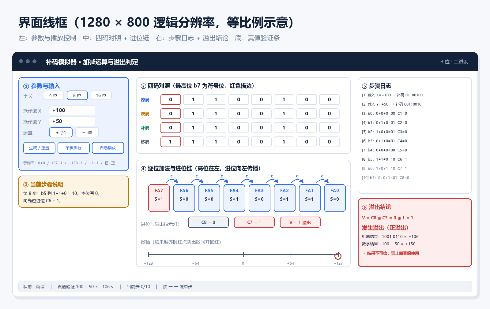

# 补码模拟器 · 加减运算与溢出判定

> 一个用 Python + Tkinter 写的**桌面可视化演示程序**，把"补码怎么求、加法怎么进位、什么时候溢出"这三件抽象的事，变成可以一步一步点着看的过程。

<p align="center">
  
</p>

<p align="center">
  <em>界面线框（1280×800）· 示例数据：<code>100 + 50</code> 溢出</em>
</p>

---

## 一、项目简介

《计算机科学基础》里"数在计算机中的表示"这一节，难的不是规则多，而是三件事同时反直觉：

- **符号位要参与运算**，不能单独拎出来处理；
- **减法被改写成加法**，中间多了一步"求补"；
- **结果可能绕回**，`100 + 50` 在 8 位机器上等于 `−106`。

教材给的是静态竖式，学生看得见答案，看不见**进位在列间流动**，也看不见**符号位与数值位的边界**。本项目要做的就是让这三件事动起来。

本项目是《计算机与专业基础研讨》综合实验的大作业，选题对应作业建议中的"补码加减法运算模拟器（重点展示**求补过程**和**溢出判断**）"。

### 核心特性

| 特性 | 说明 |
| :--- | :--- |
| 🧮 **四码对照** | 原码 / 反码 / 补码 / 移码逐位对齐，符号位红色描边 |
| 🔁 **求补演示** | 严格按"取反 → 末位加一 → 进位结束"三步推进，标出最低位第一个 `1` |
| ➕ **逐列加法** | 每列显示 `A + B + Cin = 2·Cout + S`，进位用弧形箭头跨列连接 |
| ⚠️ **三种溢出判定** | `C8 ⊕ C7`、双符号位、操作数符号法并列展示，结论必须一致 |
| 📏 **数轴可视化** | 显示 `[−2^(n−1), 2^(n−1)−1]`，结果越界时红点跳出区间 |
| ▶️ **单步 / 自动播放** | 支持调速、上一步、重置，适合课堂讲解 |
| 📝 **步骤日志** | 每步一句中文解释，可复制导出 |
| 🧩 **字长切换** | 4 / 8 / 16 位 |

### 技术约束

- **零第三方依赖**：只用 Python 标准库（`tkinter`、`dataclasses`、`unittest`/`pytest` 可选）；
- **Python ≥ 3.8**；
- **三层解耦**：核心算法层不含任何 `tkinter` 引用，可脱离界面独立测试。

---

## 二、安装与运行

### 1. 环境要求

| 项 | 要求 |
| :--- | :--- |
| 操作系统 | Windows 10/11（主要）、macOS、Linux |
| Python | 3.8 及以上（`tkinter` 随 Python 自带） |
| 第三方库 | **无** |

> Linux 若提示 `No module named tkinter`，请安装系统包：`sudo apt install python3-tk`。

### 2. 运行步骤

```bash
# 1. 克隆项目
git clone https://github.com/<你的用户名>/twos-complement-simulator.git

# 2. 进入目录
cd twos-complement-simulator

# 3. 运行
python main.py
```

Windows 下若 `python` 不可用，改用 `py main.py`。

### 3. 运行测试（可选）

```bash
python -m pytest tests/ -v
```

---

## 三、快速上手

1. **选字长**：默认 8 位，可切 4 / 16 位；
2. **输入两个数**：直接填十进制真值（如 `-5` 与 `12`），或切到二进制模式填补码串；
3. **选运算**：加号 `+` 或减号 `−`；
4. **点"生成"**：界面生成完整的步骤序列；
5. **点"单步"**：每点一次推进一列，观察进位箭头；
6. **看结论**：右下角溢出卡片给出 `V = C8 ⊕ C7` 与三种判定的结果。

**推荐的三个演示例子**

| 例子 | 输入 | 看点 |
| :--- | :--- | :--- |
| 学求补 | `−5` 与 `12`，加法 | 负数如何被"取反加一"，进位如何吃掉符号位 |
| 看溢出 | `100` 与 `50`，加法 | 正 + 正 = 负，机器结果 `−106`，数学结果 `150` |
| 踩边界 | `−128` 与 `0`，加法 | `1000 0000` 没有原码与反码，且没有相反数 |

---

## 四、目录结构

```text
twos-complement-simulator/
├── main.py                          # 程序入口
├── Project_Requirements_and_Design.md   # 需求与设计文档（主交付物）
├── AI_Prompts_Log.md                # AI 结对编程记录
├── README.md                        # 本文件
├── LICENSE                          # MIT
├── .gitignore
├── assets/                          # 文档配图
│   ├── architecture.png
│   ├── complement_principle.png
│   ├── overflow_detection.png
│   └── ui_wireframe.png
├── docs/
│   ├── Team_Task_Allocation.md      # 五人任务分配
│   ├── UI_Branch_Guide.md           # UI 分支任务书（零基础操作手册）
│   ├── GitHub_Setup_Guide.md        # 仓库搭建与推送手册
│   ├── algorithm_notes.md           # 算法推导笔记（张家昂）
│   ├── Test_Case_Matrix.md          # 16 条用例矩阵
│   ├── examples/
│   │   └── canvas_playground.py     # Canvas 参考实现（可直接运行）
│   └── images/                      # 截图、冲突留档
├── src/
│   ├── core/                        # 核心算法层（零 UI 依赖）
│   │   ├── bits.py
│   │   ├── represent.py
│   │   ├── negate.py
│   │   ├── adders.py
│   │   ├── overflow.py
│   │   ├── models.py
│   │   └── engine.py
│   └── ui/                          # 表现层
│       ├── app.py
│       ├── theme.py
│       └── widgets/
│           ├── bit_grid.py
│           ├── number_line.py
│           ├── step_panel.py
│           └── controls.py
└── tests/                           # 单元测试
```

---

## 五、Git 协作记录

### 分支规划

| 分支 | 负责人 | 内容 |
| :--- | :--- | :--- |
| `main` | 马子尊 | 稳定版本，只接受 PR 合并 |
| `chore/scaffold` | 马子尊 | 仓库初始化、规范、模板 |
| `feat/engine` | 马子尊 | 编排层与入口 |
| `feature/core-logic` | 张家昂 | 补码核心算法 |
| `feature/ui-layout` | 聂莹莹 | 界面布局与交互 |
| `feature/canvas-render` | 聂莹莹 | Canvas 渲染与动画（第二阶段） |
| `docs/feature-proposal` | 韩依桐 | 需求与设计文档 |
| `test/qa-suite` | 李昆鹏 | 测试用例与报告 |

### 提交约定

```text
<type>(<scope>): <中文简述>
```

`type` 取 `feat` / `fix` / `docs` / `test` / `refactor` / `chore`。
示例：`feat(core): 实现求补算法并返回逐步 trace`

### 冲突解决记录

本项目按作业要求**人为制造并解决了一次合并冲突**：

- 冲突文件：`src/ui/app.py` 的 `_init_window()`
- 起因：聂莹莹把窗口高度改为 `1280x840`，马子尊在同一函数追加画布尺寸参数
- 结果：保留新尺寸 **并** 保留新参数，双方协商后手工合并
- 留档：见 [`docs/GitHub_Setup_Guide.md`](docs/GitHub_Setup_Guide.md) 第 6 节与 `docs/images/`

---

## 六、团队分工

| 姓名 | 学号 | 角色 | 主要贡献 |
| :--- | :--- | :--- | :--- |
| **马子尊** | 2610250212 | 项目负责人 / 架构与集成 | 仓库与规范、`engine.py`、集成合并、README |
| **张家昂** | 待填写 | 核心算法工程师 | 四码转换、求补、加法器、溢出判定 |
| **聂莹莹** | 待填写 | 界面与可视化渲染 | 主窗口布局、控件、位网格、进位箭头 |
| **李昆鹏** | 待填写 | 测试与质量保障 | 用例执行、覆盖率报告、Bug 跟踪、演示视频 |
| **韩依桐** | 待填写 | AI 记录与文档展示 | 设计文档、15 条 AI 记录、PPT 与讲稿 |

完整任务拆解见 [`docs/Team_Task_Allocation.md`](docs/Team_Task_Allocation.md)。

---

## 七、项目状态

| 里程碑 | 状态 |
| :--- | :--- |
| M1 立项与文档 | ✅ 已完成（设计文档 v0.9，待教师审核） |
| M2 核心算法 | ⏳ 进行中 |
| M3 界面骨架 | ⏳ 待开始 |
| M4 可视化渲染 | ⏳ 待开始 |
| M5 集成与交付 | ⏳ 待开始 |

> 当前代码为**设计阶段的骨架**：模块划分、函数签名与数据结构已确定，具体算法实现由各模块负责人在对应分支完成。

---

## 八、开源协议

本项目采用 [MIT License](LICENSE) 开源，欢迎用于计算机基础课程的教学与演示。

---

<div align="center">

**「补码不补脑」小组** · 2026

</div>
