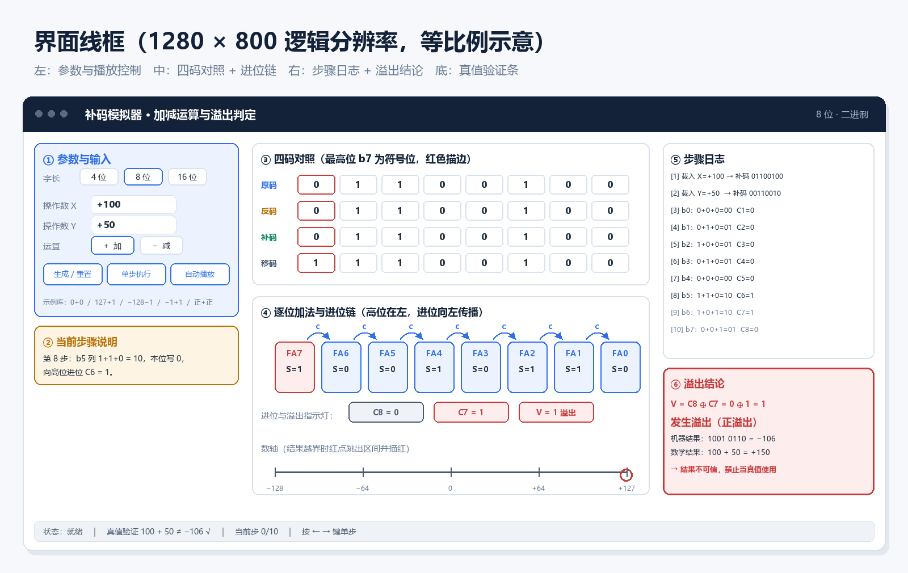
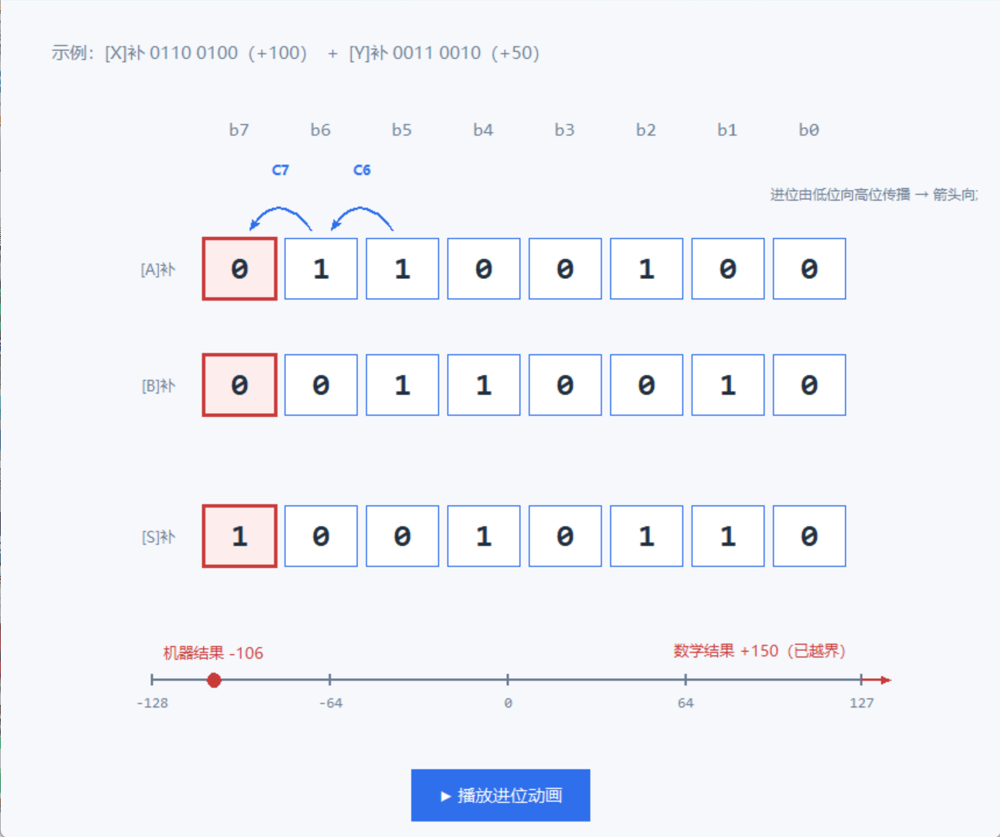

# UI 分支任务书（聂莹莹）

> 项目：补码模拟器　｜　分支：`feature/ui-layout` → `feature/canvas-render`
> 版本：v1.0　｜　更新：2026-11-08
> 适用对象：第一次用 tkinter 做界面、第一次用 Git 做协作的同学

---

## 0. 你要交付的到底是什么

**一句话**：一个能点、好看、动画正确的桌面界面。算法由张家昂提供，你负责"把它显示出来"。



> 上面这张是最终效果的目标图，源文件在 `assets/ui_wireframe.png`。

### 你手上的 6 个文件

| 文件 | 一句话职责 | 什么时候做 |
| :--- | :--- | :--- |
| `src/ui/theme.py` | 配色、字体、尺寸常量 | 第 1 周 |
| `src/ui/app.py` | 主窗口、三栏布局、状态机 | 第 2 周 |
| `src/ui/widgets/controls.py` | 左栏：输入框、按钮、调速 | 第 2 周 |
| `src/ui/widgets/step_panel.py` | 右栏：步骤日志 | 第 2 周 |
| `src/ui/widgets/bit_grid.py` | 中栏：位方块 + 进位箭头 | 第 3 周 |
| `src/ui/widgets/number_line.py` | 中栏底部：数轴与越界红点 | 第 4 周（如不足，第 3 周起交给马子尊） |

### 完成标准（DoD）

- [ ] 双击 `python main.py` 能开窗，控制台没有任何红字
- [ ] 拿一份假数据能走完「生成 → 单步 → 自动播放 → 重置」
- [ ] 1024×768 与 1600×900 下控件都不重叠、不被裁
- [ ] 8 位加法时，进位箭头从 b0 依次亮到 b7，方向向左
- [ ] 连点"自动播放" 50 次不卡死、不叠动画

---

## 1. 开工前的 30 分钟（照着做，别跳）

### 1.1 确认 Python 和 tkinter 都在

打开 PowerShell，逐条执行：

```powershell
python --version
```

期望输出类似 `Python 3.12.x`。如果提示"不是内部或外部命令"，说明 Python 没装或没加进 PATH。

```powershell
python -c "import tkinter; print('tk', tkinter.TkVersion)"
```

期望输出 `tk 8.6`。

**如果这里报 `No module named tkinter`**：说明你装 Python 时把 `tcl/tk` 那一项取消勾选了。最省事的办法是重装 Python，安装界面第一页勾上 **Add python.exe to PATH**，第二页保持默认（`tcl/tk and IDLE` 默认就是勾上的）。

### 1.2 装 VS Code 和两个插件

1. 打开 VS Code → 左侧方块图标（Extensions）→ 搜索并安装：
   - **Python**（Microsoft 官方，必装）
   - **Chinese (Simplified) Language Pack**（可选，界面变中文）
2. 左下角齿轮 → Settings → 搜索 `format on save` → 打勾（保存时自动整理代码）

### 1.3 把代码拿到本地

```powershell
cd D:\Study
git clone https://github.com/kskbl-77998/-.git twos-complement
cd twos-complement
git switch feature/ui-layout
```

> 注意最后的 `twos-complement`：因为仓库名是个减号 `-`，不指定目录名，你会得到一个叫 `-` 的文件夹。

### 1.4 先跑一次，看看现在的空壳

```powershell
python main.py
```

**你应该看到**：一个 1280×800 的窗口，深蓝色顶栏写着"补码模拟器 · 加减运算与溢出判定"，左边有三个按钮，右边是空日志框。

**如果报错**：先看最后一行。`ModuleNotFoundError: No module named 'src'` 说明你不在项目根目录下运行——`cd` 到有 `main.py` 的那一层再跑。

### 1.5 三条救命命令

```powershell
python main.py                          # 运行
python -m py_compile src/ui/app.py      # 只检查语法（比运行快，能定位到行号）
git status                              # 看我改了哪些文件
```

---

## 2. tkinter 只学这 8 个概念

别看几十页教程，做这个界面只需要下面这些。

| 概念 | 一句话 | 最小代码 |
| :--- | :--- | :--- |
| 根窗口 `Tk` | 整个程序的外框 | `root = tk.Tk()` |
| 容器 `Frame` | 一块矩形区域，用来装别的控件 | `f = tk.Frame(root, bg="#FFF")` |
| 文字 `Label` | 显示一行字 | `tk.Label(f, text="字长")` |
| 按钮 `Button` | 点了会触发函数 | `tk.Button(f, text="单步", command=fn)` |
| 输入框 `Entry` | 单行输入 | `e = tk.Entry(f); e.get()` |
| 画布 `Canvas` | 画方块、线、文字的地方 | `c = tk.Canvas(f, bg="#FFF")` |
| `pack` | 按顺序堆叠排列 | `f.pack(fill="x")` |
| `grid` | 按行列网格排列 | `w.grid(row=0, column=1)` |

### 2.1 pack 还是 grid？记住这个分工

- **大块区域用 `pack`**：顶栏、左栏、中栏、右栏、底栏。
- **表单内部用 `grid`**：左栏里的"字长 / 输入 X / 输入 Y / 运算"这种行列对齐的表单。

同一个父容器里**不要混用** pack 和 grid，会打架。

### 2.2 让侧栏固定宽度、不被内容撑大

这是新手第一个大坑。只写 `width=360` 没用，子控件放进去就会把它撑开。必须再加一句：

```python
left = tk.Frame(parent, width=360)
left.pack(side=tk.LEFT, fill=tk.Y)
left.pack_propagate(False)      # ← 关键：禁止子控件改变父容器尺寸
```

### 2.3 事件绑定的两种写法

```python
# 写法一：command（按钮专用，最简单）
tk.Button(f, text="单步", command=self.on_step)

# 写法二：bind（任意控件、任意事件）
entry.bind("<Return>", self.on_enter)      # 回车
root.bind("<Left>", lambda e: self.step(-1))   # 方向键
```

---

## 3. 任务拆解：13 个可交付的小任务

每个任务都控制在一个下午之内能完成，做完就提交一次。**不要攒到最后一起提交。**

| 编号 | 任务 | 文件 | 预计 | 依赖 |
| :--- | :--- | :--- | :--- | :--- |
| T01 | 配色与字体常量 | `theme.py` | 2h | 无 |
| T02 | 三栏 + 顶栏 + 底栏骨架 | `app.py` | 3h | T01 |
| T03 | 固定宽度侧栏与自适应中栏 | `app.py` | 1h | T02 |
| T04 | 字长单选 + 输入框 + 加减切换 | `controls.py` | 3h | T02 |
| T05 | 四个按钮 + 调速滑块 | `controls.py` | 2h | T04 |
| T06 | 输入校验与错误提示 | `controls.py` | 2h | T04 |
| T07 | 步骤日志面板 + 自动滚动 | `step_panel.py` | 3h | T02 |
| T08 | 交互状态机 | `app.py` | 3h | T05 |
| T09 | 位方块静态绘制 | `bit_grid.py` | 4h | T01 |
| T10 | 符号位描边 + 当前列高亮 | `bit_grid.py` | 2h | T09 |
| T11 | 进位弧形箭头 | `bit_grid.py` | 4h | T09 |
| T12 | 数轴 + 越界红点 | `number_line.py` | 3h | T01 |
| T13 | 动画与收尾联调 | 全部 | 4h | T08/T11/T12 |

**合计约 36 小时**，按 4 周、每周 9 小时排刚好。

---

### T01　配色与字体常量（`theme.py`）

**做什么**：把颜色、字号、尺寸统一写在一个文件里，其他文件只 `from . import theme` 引用。

**为什么重要**：后面你要改 20 次颜色，如果颜色散落在 6 个文件里，你会疯。

**怎么做**：直接照 `src/ui/theme.py` 里已有的 `COLORS`、`FONT_SIZES`、`SIZES` 三个字典填空，缺什么补什么。

**验收**：`python -c "from src.ui import theme; print(theme.COLORS['primary'])"` 能打印出 `#2F6FEB`。

---

### T02　三栏 + 顶栏 + 底栏骨架（`app.py`）

**做什么**：先把"房子"搭起来，里面什么都不放。

**关键点（顺序很重要）**：

```python
self._init_window()    # 1. 设置窗口大小
self._init_status()    # 2. 先 pack 底栏（side=BOTTOM）
self._init_layout()    # 3. 再 pack 顶栏和主区
```

底栏必须**先** pack，否则中间区域 `expand=True` 会把底栏挤没。这个坑我踩过，你也一定会踩。

**验收**：窗口能开，拉伸窗口时底栏始终贴在底部、顶栏贴顶部。

---

### T03　固定宽度侧栏与自适应中栏

**做什么**：左 360、右 320 固定，中间吃掉剩余空间。

```python
left.pack(side=tk.LEFT, fill=tk.Y)                 # 固定宽度
right.pack(side=tk.RIGHT, fill=tk.Y)               # 固定宽度
center.pack(side=tk.LEFT, fill=tk.BOTH, expand=True)  # 最后 pack，吸收多余空间
```

**注意顺序**：`center` 必须**最后** pack。Tk 按 pack 的先后顺序分配空间，先 pack 的自适应控件会把后面的挤出去。

**验收**：窗口从 1100 拉到 1600，只有中间变宽，左右不变。

---

### T04　字长单选 + 输入框 + 加减切换（`controls.py`）

**做什么**：左栏的表单区。

**关键点**：
- 用 `tk.IntVar()` 存字长，`ttk.Radiobutton` 绑同一个变量 → 自动互斥
- 输入框用 `tk.StringVar()`，方便取值和校验
- 表单部分用 `grid`，`sticky="w"` 左对齐

```python
self.var_width = tk.IntVar(value=8)
for w in (4, 8, 16):
    ttk.Radiobutton(f, text=f"{w} 位", variable=self.var_width, value=w).grid(...)
```

**验收**：点 4/8/16，只有一个被选中；`self.var_width.get()` 返回对应数字。

---

### T05　四个按钮 + 调速滑块

**做什么**：生成/重置、单步、自动播放、调速。

**关键点**：
- 按钮统一 `width`，否则宽度不齐很难看
- 滑块用 `ttk.Scale`，`from_=0.2, to=2.0`，值存在 `DoubleVar`
- 自动播放按钮要有"播放 / 暂停"两态，文字跟着变

**验收**：点按钮能在状态栏看到反馈文字（还没接算法时先打印）。

---

### T06　输入校验与错误提示

**做什么**：用户输入 `abc`、`200`（8 位越界）时，不崩溃，给出红字提示。

**关键点**：

```python
def parse(self, text, lo, hi):
    text = text.strip()
    if not text:
        raise ValueError("请输入数字")
    try:
        v = int(text)
    except ValueError:
        raise ValueError("只能输入整数")
    if not (lo <= v <= hi):
        raise ValueError(f"超出范围 [{lo}, {hi}]")
    return v
```

校验失败时：输入框描红（`entry.configure(highlightbackground="#C93B3B")`）+ 底栏提示，**不要弹 messagebox**（打断演示节奏）。

**验收**：故意输错 5 种输入，程序都不崩。

---

### T07　步骤日志面板 + 自动滚动（`step_panel.py`）

**做什么**：右栏的日志列表，每一步一行，自动滚到当前行。

**关键点**：
- `tk.Text` 默认可编辑，要 `state=tk.DISABLED` 锁住，写入前临时改回 `NORMAL`
- 高亮当前行用 `tag_add("current", "行首", "行尾")` + `tag_configure` 设背景色
- 自动滚动：`text.see("行号.0")`

```python
self.text.configure(state=tk.NORMAL)
self.text.insert("end", line + "\n")
self.text.configure(state=tk.DISABLED)
self.text.see("end")
```

**验收**：塞 30 行假日志，能滚动、能高亮当前行。

---

### T08　交互状态机（`app.py`）

**做什么**：让程序知道"现在能不能点"。

```text
IDLE ──输入合法──► READY ──单步/播放──► RUNNING ──最后一步──► DONE
  ▲                  │                     │                    │
  └──────重置────────┴─────────────────────┴────────────────────┘
```

**规则**：
- `RUNNING` 时禁用输入框和"生成"按钮（否则播放到一半数据变了）
- `DONE` 后允许"上一步"回退
- 任何状态下"重置"都可用

**验收**：播放中改不了输入；重置后回到 IDLE。

---

### T09　位方块静态绘制（`bit_grid.py`）★核心

**做什么**：画出 8 个方块，每块显示一个 0/1，对齐、居中。

**坐标公式（背下来）**：

```python
total_w = n * CELL_W + (n - 1) * CELL_GAP
x0 = (canvas_w - total_w) / 2          # 整体水平居中
x = x0 + i * (CELL_W + CELL_GAP)       # 第 i 列的左边界
```

**验收**：8 个方块等宽等距、整体居中、窗口变宽时跟着居中。

**参考实现**：`docs/examples/canvas_playground.py` 里的 `draw_bit_grid()`。

---

### T10　符号位描边 + 当前列高亮

**做什么**：最高位永远红色描边；当前计算的那一列淡蓝底 + 加粗边框。

| 状态 | 边框色 | 边框宽 | 底色 |
| :--- | :--- | ---: | :--- |
| 普通 | `#2F6FEB` | 1 | `#FFFFFF` |
| 符号位 | `#C93B3B` | 3 | `#FDEDED` |
| 当前列 | `#2F6FEB` | 3 | `#EDF3FE` |
| 两者叠加 | 以符号位为准 | 3 | `#FDEDED` |

**验收**：`col=0` 时最左边（符号位）变色；`col=3` 时第 4 块变色。

---

### T11　进位弧形箭头（`bit_grid.py`）★★最容易画错

**做什么**：在两根相邻的列之间画一条向上凸的弧线，并标 `C7`、`C6`……

**几何规范**：

| 参数 | 值 | 说明 |
| :--- | :--- | :--- |
| 起点 | 右列中心 x − 8，行顶 y − 6 | 从右往左画 |
| 终点 | 左列中心 x + 8，行顶 y − 6 | |
| 控制点 | 两端中点，y − 38 | 决定拱起高度 |
| 线宽 | 2 | |
| 箭头 | `arrow="last"`，`arrowshape=(9,11,3)` | Tk 自带，不用自己画三角形 |
| 标签 | 控制点上方 6px，`anchor="s"`，9pt 粗体 | |

```python
def draw_carry(self, x_from, x_to, label):
    ctrl_x = (x_from + x_to) / 2
    ctrl_y = row_top - 38
    self.canvas.create_line(
        x_from, row_top, ctrl_x, ctrl_y, x_to, row_top,
        smooth=True, width=2, fill=COLOR_PRIMARY,
        arrow="last", arrowshape=(9, 11, 3), tags="carry")
    self.canvas.create_text(ctrl_x, ctrl_y - 6, text=label,
                            font=("Microsoft YaHei", 9, "bold"),
                            fill=COLOR_PRIMARY, anchor="s", tags="carry")
```

**⚠️ 方向为什么是向左？**
`C_i` 表示"从第 `i−1` 位进到第 `i` 位"。而在画面上 **b0 在最右、b7 在最左**，所以进位是从右往左走的——箭头必须指向左。

这条我第一版就画反了，直到把 `100 + 50` 的进位手算了一遍才发现。**画完一定要用真数据验证一次。**

**验收**：`100 + 50` 时，b6→b7 和 b5→b6 各有一条箭头，标签是 `C7` 和 `C6`。

---

### T12　数轴 + 越界红点（`number_line.py`）

**做什么**：一条横线，标出 `[−2^(n−1), 2^(n−1)−1]`，红点标出结果。

**唯一需要记的公式**：

```python
def to_x(v):
    return left + (v - lo) / (hi - lo) * (right - left)
```

**规范**：
- 8 位：区间 `[−128, 127]`，刻度画 `−128 / −64 / 0 / 64 / 127`
- 红点半径 6，越界时画在区间外侧（左端 −16 或右端 +16），并加红色文字说明
- 数轴不参与动画，静态即可

**验收**：结果 `−106` 的红点落在 `−128` 与 `−64` 之间，位置与线性比例吻合。

---

### T13　动画与收尾

**做什么**：把静态图变成"一列一列亮过去"。

**铁律**：

```python
# ✅ 正确：用 after 排下一帧
self.timer = self.root.after(450, self.next_column)

# ❌ 错误：sleep 会冻结整个窗口（窗口变灰、按钮点不动）
time.sleep(0.45)
self.draw()
```

**注意**：
- 同一时刻只能有一个 `timer`，否则连点按钮会叠出多个动画
- 每次重绘只清自己的图元：`canvas.delete("cell")` / `canvas.delete("carry")`，**不要 `delete("all")`**（会把别的模块画的东西也删掉）
- 动画期间禁用按钮

---

## 4. UI 渲染规范（硬指标，照抄即可）

### 4.1 尺寸表

| 项 | 值 | 备注 |
| :--- | :--- | :--- |
| 窗口 | 1280 × 800 | 最小 1100 × 700 |
| 顶栏高 | 62 px | 深色 `#132238` |
| 底栏高 | 52 px | `#EFF2F6` |
| 左栏宽 | 360 px | 固定 |
| 右栏宽 | 320 px | 固定 |
| 中栏 | 自适应 | `fill=BOTH, expand=True` |
| 位方块 | 62 × 52 px | 间隙 8 px |
| 边距 | 12 px | 栏与栏之间 |

### 4.2 配色表

| 用途 | 色值 |
| :--- | :--- |
| 主色（按钮、可交互） | `#2F6FEB` |
| 主色浅底（高亮列） | `#EDF3FE` |
| 危险（符号位、溢出） | `#C93B3B` |
| 危险浅底 | `#FDEDED` |
| 警示（求补提示） | `#B8730A` |
| 成功（校验通过） | `#12855E` |
| 背景 | `#F6F8FB` |
| 卡片 | `#FFFFFF` |
| 正文 / 次要文字 | `#22303F` / `#6B7C93` |
| 边框 | `#D9E1EC` |

### 4.3 字体与 DPI

| 场景 | 字体 | 字号 |
| :--- | :--- | ---: |
| 标题 | 微软雅黑 Bold | 16 |
| 分区标题 | 微软雅黑 Bold | 11 |
| 正文 | 微软雅黑 | 10 |
| 小字 / 日志 | 微软雅黑 | 9 |
| **位数字 / 数字** | **Consolas** | **20 / 12** |

**位数字必须用等宽字体**，否则 `0` 和 `1` 宽度不同，位对不齐——这直接毁掉"位对齐"这个教学意图。

**DPI 缩放**（高分屏上不这么写，字会小到看不清）：

```python
def base_scale(root):
    cached = getattr(root, "_dpi_scale", None)
    if cached is not None:
        return cached
    try:
        s = float(root.tk.call("tk", "scaling"))
    except Exception:
        s = 1.0
    s = max(0.8, min(2.0, s))     # ← 必须钳制，否则 4K 屏字号爆炸
    root._dpi_scale = s
    return s
```

### 4.4 位网格规范

- 顺序：**b7 在最左，b0 在最右**（和教材竖式一致）
- 三行：`[A]补`、`[B]补`、`[S]补`，行标签右对齐在方块左侧 24px
- 位序号 `b7…b0` 画在方块上方 22px，灰色 12px
- 数字垂直水平都居中：`create_text(x + w/2, y + h/2, anchor="center")`

### 4.5 进位箭头规范

见 T11。补充两条：

- 只在 `C_i = 1` 时画，`C_i = 0` 不画（否则满屏箭头）
- 箭头画在**操作数行上方**，不要画在数字中间挡字

### 4.6 数轴规范

- 只画 5 个刻度：`lo / −64 / 0 / 64 / hi`（16 位同理按比例取 5 个）
- 刻度线长 5px，文字在下方 12px
- 红点直径 12px，越界时**跳过区间外**并加文字

### 4.7 动画规范

| 项 | 值 |
| :--- | :--- |
| 每列停留 | 400–600 ms（默认 450） |
| 最小间隔 | 200 ms（调速滑块下限） |
| 重绘方式 | 只删自己的 tag，不 `delete("all")` |
| 定时器 | 单例，`after` 返回值存 `self.timer` |
| 结束时 | 复位 `self.timer = None`，恢复按钮 |

### 4.8 性能红线

- 16 位模式下，画布图元数应 < 200；
- 连续播放 50 次，`len(canvas.find_all())` 不增长（不增长 = 没有图元泄漏）；
- 单次重绘耗时 < 30 ms（用 `time.perf_counter()` 量一下）。

---

## 5. 直接能用的代码片段

完整可运行版本见 **`docs/examples/canvas_playground.py`**，运行：

```powershell
python docs/examples/canvas_playground.py
```

它画出来的效果就是你要做的目标：



### 5.1 固定宽度的侧栏

```python
left = tk.Frame(parent, width=360, bg=theme.COLORS["panel"])
left.pack(side=tk.LEFT, fill=tk.Y)
left.pack_propagate(False)     # 关键
```

### 5.2 位方块（含居中数字）

```python
self.canvas.create_rectangle(x, y, x + W, y + H, fill=fill,
                             outline=outline, width=width, tags="cell")
self.canvas.create_text(x + W / 2, y + H / 2, text=str(bit),
                        font=("Consolas", 20, "bold"), fill=INK, tags="cell")
```

### 5.3 进位箭头（方向向左）

```python
ctrl_x = (x_from + x_to) / 2
ctrl_y = row_top - 38
self.canvas.create_line(x_from, row_top, ctrl_x, ctrl_y, x_to, row_top,
                        smooth=True, width=2, fill="#2F6FEB",
                        arrow="last", arrowshape=(9, 11, 3), tags="carry")
```

### 5.4 数轴映射

```python
def to_x(v):
    return left + (v - lo) / (hi - lo) * (right - left)
```

### 5.5 单例定时器（防连点）

```python
def start(self):
    if self.timer is not None:
        return                      # 已有动画在跑
    self.btn.configure(state=tk.DISABLED)
    self.timer = self.root.after(450, self.next)

def next(self):
    self.i += 1
    if self.i >= self.n:
        self.timer = None
        self.btn.configure(state=tk.NORMAL)
        return
    self.draw()
    self.timer = self.root.after(450, self.next)
```

### 5.6 日志自动滚动

```python
self.text.configure(state=tk.NORMAL)
self.text.insert("end", f"[{i}] {msg}\n")
self.text.configure(state=tk.DISABLED)
self.text.see("end")
```

### 5.7 输入校验

```python
def parse_operand(text, lo, hi):
    text = text.strip()
    if not text:
        raise ValueError("不能为空")
    try:
        v = int(text)
    except ValueError:
        raise ValueError("请输入整数")
    if not (lo <= v <= hi):
        raise ValueError(f"范围是 [{lo}, {hi}]")
    return v
```

---

## 6. 工具怎么用

### 6.1 VS Code 必会快捷键

| 快捷键 | 作用 | 你会用在哪 |
| :--- | :--- | :--- |
| `Ctrl + `` ` | 打开终端 | 跑程序 |
| `F5` | 调试运行 | 断点调试 |
| `Ctrl + /` | 注释/取消注释 | 临时屏蔽代码 |
| `Alt + ↑/↓` | 上下移动整行 | 调整控件顺序 |
| `Ctrl + D` | 选中下一个相同的词 | 批量改名 |
| `Ctrl + Shift + F` | 全局搜索 | 找"这个变量在哪用过" |
| `Ctrl + P` | 快速打开文件 | 跳文件 |
| `Shift + Alt + F` | 格式化代码 | 提交前整理 |

### 6.2 三种调试手段（按使用频率排序）

**① print（90% 的情况够用）**

```python
print("canvas size:", self.canvas.winfo_width(), self.canvas.winfo_height())
```

**② 断点（查"为什么没执行"）**
在行号左边点一下出现红点 → `F5` 启动 → 程序停在那里 → 鼠标悬停看变量值。

**③ logging（不想删 print 时）**

```python
import logging
logging.basicConfig(level=logging.DEBUG)
logging.debug("列 %d 的进位 = %d", i, carry)
```

### 6.3 tkinter 专用排查三招

| 现象 | 命令 | 看什么 |
| :--- | :--- | :--- |
| 控件没显示 | `print(widget.winfo_width(), widget.winfo_height())` | 如果是 1×1，说明没被 pack 或被压扁 |
| 画面重影 / 越来越卡 | `print(len(canvas.find_all()))` | 数字一直涨 = 图元没删干净 |
| 动画越点越快 | `print(id(self.timer))` | 出现多个不同 id = 定时器泄漏 |

### 6.4 取色与截图

- **取色**：按 `Win + Shift + S` 截图到剪贴板 → 粘到画图 → 吸管取色；或用浏览器打开 <https://htmlcolorcodes.com/color-picker/> 直接读。
- **截图**：`Win + Shift + S`，存到 `docs/images/`，文件名用小写英文（如 `ui-main.png`）。

### 6.5 高 DPI 一定要测

Windows 设置 → 显示 → 缩放，分别切 **100% / 125% / 150%**，每次重开程序看一眼：

- 字有没有大到挤在一起？
- 位方块有没有跑到窗口外？

---

## 7. 12 个最常见的坑

| # | 现象 | 原因 | 一句话解决 |
| :--- | :--- | :--- | :--- |
| 1 | 控件完全看不见 | 忘了 `pack()`，或父容器尺寸为 0 | 每个控件创建后都要 pack/grid |
| 2 | 侧栏被内容撑宽 | 没写 `pack_propagate(False)` | 加上这一行 |
| 3 | 底栏被挤出窗口 | 底栏在中间区之后才 pack | 先 pack 底栏（`side=BOTTOM`） |
| 4 | 拉伸窗口后一片空白 | 中间区没 `expand=True` | `pack(fill=BOTH, expand=True)` |
| 5 | Canvas 画了没反应 | 坐标超出可视区 / 没 `update()` | 先 `print(canvas.winfo_width())` 确认真实宽度 |
| 6 | 中文变成方块 | 字体名写错 | 用 `("Microsoft YaHei", 10)` |
| 7 | 高分屏字巨大 | 没钳制 `tk scaling` | `max(0.8, min(2.0, s))` |
| 8 | 动画时窗口卡死 | 用了 `time.sleep()` | 改用 `after()` |
| 9 | 画面重影、越来越卡 | `delete("all")` 后又重复添加 / 没删 | 给图元打 tag，只删自己的 |
| 10 | 连点播放跑出多个动画 | 定时器没做单例 | `if self.timer: return` |
| 11 | 文字被控件边缘裁掉 | 控件高度不够 | 加大 `height` 或用 `padx/pady` 留白 |
| 12 | 颜色和设计稿不一致 | 各处硬编码 | 全部改成 `theme.COLORS[...]` |

---

## 8. 四周节奏 & 每天三行

| 周次 | 你要完成的 | 分支 |
| :--- | :--- | :--- |
| 第 1 周 | T01 配色 + 纸上草图 + 跑通空壳 | `feature/ui-layout` |
| 第 2 周 | T02–T08：布局、控件、日志、状态机 | `feature/ui-layout` |
| 第 3 周 | T09–T11：位方块、高亮、进位箭头（合并布局分支后开工） | `feature/canvas-render` |
| 第 4 周 | T12–T13：数轴、动画、联调修排版 | `feature/canvas-render` |

**每天收工前在群里发三行**：

```text
【今日完成】T09 位方块画出来了，8 个对齐
【今日卡点】箭头一画就把数字挡住了
【明日计划】试两种抬升高度，截图对比
```

---

## 9. 交付前自检清单

- [ ] `python main.py` 无红字
- [ ] 100% / 125% / 150% 三种缩放下字体正常
- [ ] 1024×768 不重叠、无横向滚动条
- [ ] 假数据能走完单步 / 播放 / 重置
- [ ] 播放中无法修改输入
- [ ] 连点自动播放 50 次不卡、不叠
- [ ] `len(canvas.find_all())` 播放前后一致
- [ ] 8 位 `100+50` 的箭头方向、标签、数量都对
- [ ] 数轴红点位置与线性比例一致
- [ ] 所有颜色都来自 `theme.COLORS`，无硬编码
- [ ] 每个文件头写了负责人注释
- [ ] 提交信息符合 `type(scope): 说明` 格式

---

## 10. 如果你只剩 2 天（最小可行版）

按这个顺序做，做完就够演示：

1. **T02** 三栏骨架（2 小时）——先让窗口像样
2. **T09** 位方块 + **T10** 符号位（4 小时）——四码对照能看
3. **T11** 进位箭头（3 小时）——这是评分重点，必做
4. **T07** 日志面板（2 小时）——能讲清楚每一步在干嘛
5. 其余全部砍掉：数轴、动画、快捷键、主题切换

**不能砍的三样**：位方块、进位箭头、日志。它们直接对应"可视化"和"演示"这两个得分点。

---

<div align="center">

**卡住了就在群里发报错原文 + 截图，别自己憋超过 1 小时。**

</div>
